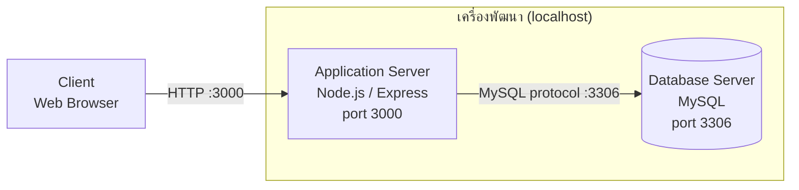
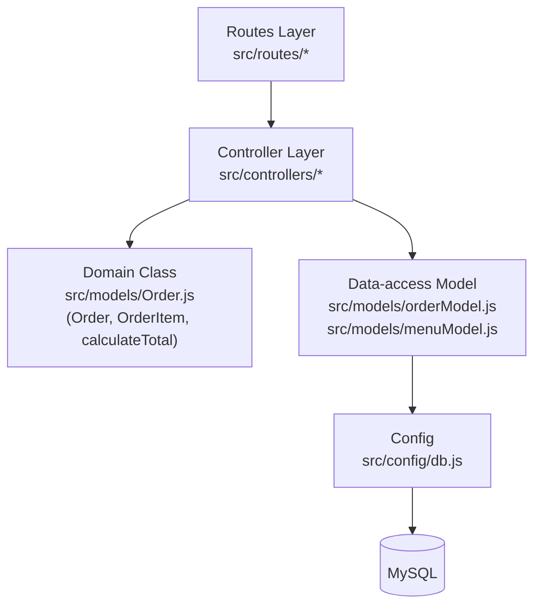
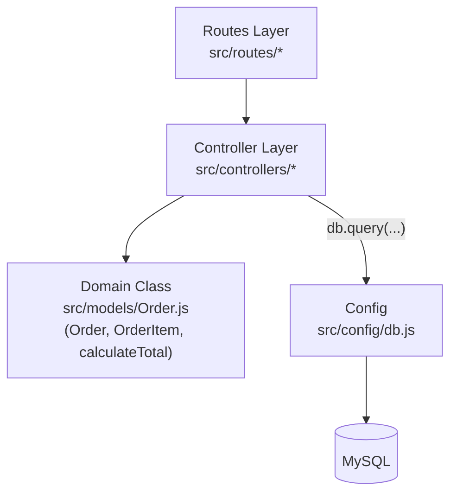

# สถาปัตยกรรมระบบร้านกาแฟ (Week 11 Workshop)

## 1. Physical View (Deployment Topology)

กลุ่มของเรารันทุกอย่างบนเครื่องพัฒนาเครื่องเดียว (localhost) โดย Node.js server และ MySQL อยู่เครื่องเดียวกัน ไม่มี load balancer และไม่มีเซิร์ฟเวอร์แยกตามสาขา (หลายสาขาจำลองด้วย `branch_id` ในฐานข้อมูลเดียว)

## 2. Development View (การแบ่ง Component/Module)

โครงสร้างโฟลเดอร์ใน `src/` ที่ตรวจกับ repo จริงของกลุ่ม: `routes/`, `controllers/`, `models/`, `config/db.js`

**เวอร์ชันที่ใช้: (ก) กลุ่มที่แยก Data-access Model แล้ว** (`models/` มีทั้ง `Order.js` และ `orderModel.js`/`menuModel.js`)

<!--
สลับเป็นเวอร์ชัน (ข) ถ้ากลุ่มยังไม่ได้แยก Data-access Model
(Controller เรียก db.query ตรง แต่มี Order.js ตาม wk06)
ให้ลบ diagram (ก) ด้านบน แล้วใช้ diagram นี้แทน:

-->

**ข้อจำกัดที่ทราบ (Known Limitation):** endpoint `createOrder` ยังไม่มี database transaction ครอบ flow การตัดสต็อก ดังนั้นหากขั้นตอนใดล้มเหลวกลางทาง ข้อมูลสต็อกอาจไม่สอดคล้องกับคำสั่งซื้อ diagram นี้จึงไม่ควรถูกตีความว่าการตัดสต็อกปลอดภัยครบถ้วน (ข้อจำกัดนี้เกี่ยวกับ endpoint สั่งซื้อเท่านั้น ไม่เกี่ยวกับ CRUD เมนู)

**ตรวจความสอดคล้องกับ repo:**
- [ ] ทุกโฟลเดอร์/ไฟล์ใน diagram มีอยู่จริงใน `src/`
- [ ] ไฟล์ทุกชนิดใน `src/models/` ปรากฏใน diagram ครบ
- [ ] `src/config/db.js` ตรงกับลูกศรไป MySQL
- [ ] Physical View ตรงกับจำนวนเครื่องที่ใช้จริง

## 3. สรุปสถาปัตยกรรม

กลุ่มเราใช้สถาปัตยกรรมแบบ **Monolithic + Layered** เพราะระบบ deploy เป็น Node.js process เดียวที่ `localhost:3000` และทีมมี [5] คน จึงไม่คุ้มกับความซับซ้อนของ Microservices เรายังแบ่ง layer ภายในเป็น `routes` / `controllers` / `models` ตามที่ตั้งไว้ตั้งแต่สัปดาห์ 5 เพื่อแยกความรับผิดชอบ (separation of concerns) และขอบเขตระบบยังอยู่ใน 4 ฟีเจอร์หลักตามโจทย์ (เมนู, POS, สต็อก, รายงาน) จึงยังไม่จำเป็นต้องแยก service นอกจากนี้ฐานข้อมูลเดียวรองรับหลายสาขาโดยใช้ `branch_id` จึงมี Database Server เพียงเครื่องเดียว

## อ้างอิงมุมมองอื่นใน 4+1

| View | เอกสารของกลุ่ม |
|---|---|
| Scenarios | Use Case Diagram (สัปดาห์ 4) |
| Logical | Class Diagram (สัปดาห์ 6) |
| Process | Sequence Diagram createOrder (สัปดาห์ 9) |
| Development | หัวข้อ 2 ของไฟล์นี้ |
| Physical | หัวข้อ 1 ของไฟล์นี้ |
